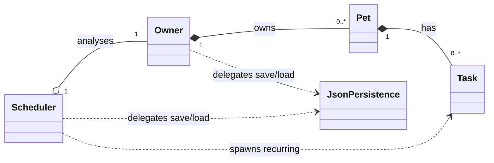

# 🐾 PawPal+ — Smart Pet Care Scheduler

PawPal+ is an object-oriented pet care manager written in Python. An owner registers pets, adds care tasks (walks, feeding, medication, grooming…), and PawPal+ keeps the day organised: it **sorts** by priority and time, **filters** across pets, **warns about overlapping tasks**, **auto-schedules recurring tasks**, **finds the next free time slot**, and **saves everything to JSON**. It ships with a Streamlit web app, a colourful CLI demo, and a pytest suite.

---

## 📐 System Architecture

The design is four domain classes plus a small persistence handler. The full diagram lives in [`diagrams/uml_final.mmd`](diagrams/uml_final.mmd) and renders on GitHub:



*(Simplified here for readability — attributes and methods for every class are in `diagrams/uml_final.mmd`.)*

| Class | Responsibility |
|---|---|
| `Task` | One care activity: description, date/time, duration, category, priority, frequency, status. Validates its own input. |
| `Pet` | Owns a list of `Task`s; add/remove/list them. Stamps each task with its `pet_id`. |
| `Owner` | Owns a list of `Pet`s; exposes `get_all_tasks()` so algorithms work across every pet. |
| `Scheduler` | "The brain" — all algorithms. Stateless apart from the `Owner` it analyses, so it is trivial to rebuild on every Streamlit rerun. |
| `JsonPersistence` | Versioned, atomic JSON save/load of the whole object graph. |

**Why composition?** Deleting a pet deletes its tasks, and deleting an owner deletes their pets (`*--`). The `Scheduler` only *observes* an owner (`o--`), so it holds a reference and owns nothing.

---

## ✨ Core Features & Smarter Scheduling Algorithms

### 1. Sorting — `Scheduler.sort_tasks()`
Multi-tier sort across **all pets**: priority (High → Medium → Low), then date, then time. `by="time"` gives a chronological day-planner view instead. Python's sort is stable and the key is a tuple, so it runs in O(n log n) with deterministic tie-breaking.

### 2. Filtering — `Scheduler.filter_tasks()`
Combine any of `status`, `pet` (id **or** name), `category`, `priority` and `date`; criteria are AND-ed and case-insensitive. Composes with sorting: `sort_tasks(filter_tasks(pet="Luna"))`.

### 3. Conflict Detection & Time-Blocking — `Scheduler.detect_conflicts()`
Each task occupies a half-open window `[time, time + duration)`. Tasks on the same date are sorted by start and swept with an early exit, so only genuinely overlapping pairs are examined. Back-to-back tasks (08:00–08:30 then 08:30–09:00) are **not** conflicts. Because one owner performs every task, overlaps are flagged **across pets** too, and the warning says how many minutes overlap and whether the clash is the same pet or different pets. Completed tasks are ignored by default.

### 4. Automated Recurrence — `Scheduler.handle_recurring_task()` / `complete_task()`
Completing a **Daily** or **Weekly** task spawns the next occurrence using `datetime.timedelta(days=1 | weeks=1)`, so month ends, year ends and leap days are handled by the standard library rather than hand-rolled maths. It is **idempotent** (completing twice never double-spawns) and de-duplicates if the next occurrence already exists.

### 5. ⭐ Next Available Slot Finder — `Scheduler.find_next_available_slot()`
Given a duration and a search window, PawPal+ merges busy intervals for the day and walks the gaps, returning the earliest `HH:MM` that fits (or `None`). `get_free_windows()` exposes every gap, and a `pet=` argument restricts the search to one pet's schedule instead of the whole household. An exact fit counts (a 30-minute gap fits a 30-minute task).

---

## 🎨 Professional UI & CLI Output Formatting

- **CLI (`main.py`)** — tables rendered with [`tabulate`](https://pypi.org/project/tabulate/) (`rounded_outline`), **ANSI colours** for priorities (red/yellow/green) and statuses, and **emoji** section headers. Colours switch on automatically in a real terminal and off when output is piped or `NO_COLOR` is set (set `FORCE_COLOR=1` to force them). Emoji are kept out of table cells on purpose: without the optional `wcwidth` package, `tabulate` mis-measures double-width characters and borders drift. `wcwidth` is in `requirements.txt`.
- **Streamlit (`app.py`)** — tabs, metrics, emoji category icons, 🔴🟡🟢 priority badges, ✅/⏳ status badges, `st.warning` banners for each conflict, `st.dataframe` tables, and an expander with the same `tabulate` text report.

---

## 💾 Data Persistence Workflow

```python
owner.save_to_json("data.json")             # or scheduler.save_to_json(...)
owner = Owner.load_from_json("data.json")   # or Scheduler.load_from_json(...)
```

- The file is a versioned document: `{"version": 1, "owner": {…pets…tasks…}}`.
- Saves are **atomic** (write to a temp file, then `os.replace`), so a crash can't leave a half-written `data.json`.
- Loading a missing file raises `FileNotFoundError`; malformed or incomplete JSON raises a clear `ValueError`.
- The Streamlit app auto-loads `data.json` on first run and has **Save**, **Load** and **Download JSON** buttons in the sidebar.
- `data.json` is git-ignored so personal data isn't committed.

---

## 🚀 Quickstart

```bash
python -m venv .venv
source .venv/bin/activate        # Windows: .venv\Scripts\activate
pip install -r requirements.txt

python main.py                   # CLI demo (colour in a terminal)
streamlit run app.py             # web app
python -m pytest                 # run the test suite
```

### Project layout

```
pawpal_system.py        Task, Pet, Owner, Scheduler, JsonPersistence
app.py                  Streamlit UI
main.py                 CLI demonstration
tests/test_pawpal.py    pytest suite (11 tests)
diagrams/uml_final.mmd  Mermaid class diagram
reflection.md           design reflection
ai_interactions.md      AI workflow + model comparison
```

---

## 🖥️ Sample CLI Output (`python main.py`)

Captured with colours off (piped output):

```text
🐾  PawPal+ — Smart Pet Care Scheduler  (CLI demo)
Owner: Alex <alex@example.com>   |   Demo date: 2026-10-13
Pets : Luna the Dog (Labrador, 4y), Mochi the Cat (Siamese, 2y)

📋  1. Tasks as entered (unsorted)
──────────────────────────────────────────────────────────────────────────
╭────────────┬─────────────┬───────┬────────────────────┬────────────┬────────────┬───────┬──────────┬───────────╮
│ Date       │ Window      │ Pet   │ Task               │ Category   │ Priority   │ Dur   │ Repeat   │ Status    │
├────────────┼─────────────┼───────┼────────────────────┼────────────┼────────────┼───────┼──────────┼───────────┤
│ 2026-10-13 │ 18:10-18:40 │ Luna  │ Evening training   │ Enrichment │ ● Medium   │ 30m   │ Once     │ ○ Pending │
│ 2026-10-13 │ 07:30-08:00 │ Luna  │ Morning walk       │ Exercise   │ ● High     │ 30m   │ Daily    │ ○ Pending │
│ 2026-10-13 │ 12:00-12:05 │ Luna  │ Heartworm pill     │ Medication │ ● High     │ 5m    │ Once     │ ○ Pending │
│ 2026-10-13 │ 17:30-17:45 │ Luna  │ Dinner             │ Feeding    │ ● High     │ 15m   │ Daily    │ ○ Pending │
│ 2026-10-13 │ 18:00-18:20 │ Mochi │ Grooming brush-out │ Grooming   │ ● Low      │ 20m   │ Weekly   │ ○ Pending │
│ 2026-10-13 │ 07:45-08:00 │ Mochi │ Breakfast          │ Feeding    │ ● High     │ 15m   │ Daily    │ ○ Pending │
│ 2026-10-13 │ 09:00-09:20 │ Mochi │ Laser-pointer play │ Enrichment │ ● Medium   │ 20m   │ Once     │ ○ Pending │
╰────────────┴─────────────┴───────┴────────────────────┴────────────┴────────────┴───────┴──────────┴───────────╯

🔝  2. Sorted by Priority (High → Low), then Date/Time
──────────────────────────────────────────────────────────────────────────
╭────────────┬─────────────┬───────┬────────────────────┬────────────┬────────────┬───────┬──────────┬───────────╮
│ Date       │ Window      │ Pet   │ Task               │ Category   │ Priority   │ Dur   │ Repeat   │ Status    │
├────────────┼─────────────┼───────┼────────────────────┼────────────┼────────────┼───────┼──────────┼───────────┤
│ 2026-10-13 │ 07:30-08:00 │ Luna  │ Morning walk       │ Exercise   │ ● High     │ 30m   │ Daily    │ ○ Pending │
│ 2026-10-13 │ 07:45-08:00 │ Mochi │ Breakfast          │ Feeding    │ ● High     │ 15m   │ Daily    │ ○ Pending │
│ 2026-10-13 │ 12:00-12:05 │ Luna  │ Heartworm pill     │ Medication │ ● High     │ 5m    │ Once     │ ○ Pending │
│ 2026-10-13 │ 17:30-17:45 │ Luna  │ Dinner             │ Feeding    │ ● High     │ 15m   │ Daily    │ ○ Pending │
│ 2026-10-13 │ 09:00-09:20 │ Mochi │ Laser-pointer play │ Enrichment │ ● Medium   │ 20m   │ Once     │ ○ Pending │
│ 2026-10-13 │ 18:10-18:40 │ Luna  │ Evening training   │ Enrichment │ ● Medium   │ 30m   │ Once     │ ○ Pending │
│ 2026-10-13 │ 18:00-18:20 │ Mochi │ Grooming brush-out │ Grooming   │ ● Low      │ 20m   │ Weekly   │ ○ Pending │
╰────────────┴─────────────┴───────┴────────────────────┴────────────┴────────────┴───────┴──────────┴───────────╯

🕒  2b. Sorted chronologically (day planner view)
──────────────────────────────────────────────────────────────────────────
╭────────────┬─────────────┬───────┬────────────────────┬────────────┬────────────┬───────┬──────────┬───────────╮
│ Date       │ Window      │ Pet   │ Task               │ Category   │ Priority   │ Dur   │ Repeat   │ Status    │
├────────────┼─────────────┼───────┼────────────────────┼────────────┼────────────┼───────┼──────────┼───────────┤
│ 2026-10-13 │ 07:30-08:00 │ Luna  │ Morning walk       │ Exercise   │ ● High     │ 30m   │ Daily    │ ○ Pending │
│ 2026-10-13 │ 07:45-08:00 │ Mochi │ Breakfast          │ Feeding    │ ● High     │ 15m   │ Daily    │ ○ Pending │
│ 2026-10-13 │ 09:00-09:20 │ Mochi │ Laser-pointer play │ Enrichment │ ● Medium   │ 20m   │ Once     │ ○ Pending │
│ 2026-10-13 │ 12:00-12:05 │ Luna  │ Heartworm pill     │ Medication │ ● High     │ 5m    │ Once     │ ○ Pending │
│ 2026-10-13 │ 17:30-17:45 │ Luna  │ Dinner             │ Feeding    │ ● High     │ 15m   │ Daily    │ ○ Pending │
│ 2026-10-13 │ 18:00-18:20 │ Mochi │ Grooming brush-out │ Grooming   │ ● Low      │ 20m   │ Weekly   │ ○ Pending │
│ 2026-10-13 │ 18:10-18:40 │ Luna  │ Evening training   │ Enrichment │ ● Medium   │ 30m   │ Once     │ ○ Pending │
╰────────────┴─────────────┴───────┴────────────────────┴────────────┴────────────┴───────┴──────────┴───────────╯

🔎  3. Filtering
──────────────────────────────────────────────────────────────────────────
Luna's tasks:
╭────────────┬─────────────┬───────┬──────────────────┬────────────┬────────────┬───────┬──────────┬───────────╮
│ Date       │ Window      │ Pet   │ Task             │ Category   │ Priority   │ Dur   │ Repeat   │ Status    │
├────────────┼─────────────┼───────┼──────────────────┼────────────┼────────────┼───────┼──────────┼───────────┤
│ 2026-10-13 │ 07:30-08:00 │ Luna  │ Morning walk     │ Exercise   │ ● High     │ 30m   │ Daily    │ ○ Pending │
│ 2026-10-13 │ 12:00-12:05 │ Luna  │ Heartworm pill   │ Medication │ ● High     │ 5m    │ Once     │ ○ Pending │
│ 2026-10-13 │ 17:30-17:45 │ Luna  │ Dinner           │ Feeding    │ ● High     │ 15m   │ Daily    │ ○ Pending │
│ 2026-10-13 │ 18:10-18:40 │ Luna  │ Evening training │ Enrichment │ ● Medium   │ 30m   │ Once     │ ○ Pending │
╰────────────┴─────────────┴───────┴──────────────────┴────────────┴────────────┴───────┴──────────┴───────────╯

High-priority feeding tasks:
╭────────────┬─────────────┬───────┬───────────┬────────────┬────────────┬───────┬──────────┬───────────╮
│ Date       │ Window      │ Pet   │ Task      │ Category   │ Priority   │ Dur   │ Repeat   │ Status    │
├────────────┼─────────────┼───────┼───────────┼────────────┼────────────┼───────┼──────────┼───────────┤
│ 2026-10-13 │ 17:30-17:45 │ Luna  │ Dinner    │ Feeding    │ ● High     │ 15m   │ Daily    │ ○ Pending │
│ 2026-10-13 │ 07:45-08:00 │ Mochi │ Breakfast │ Feeding    │ ● High     │ 15m   │ Daily    │ ○ Pending │
╰────────────┴─────────────┴───────┴───────────┴────────────┴────────────┴───────┴──────────┴───────────╯

🚨  4. Conflict detection (time + duration windows, across all pets)
──────────────────────────────────────────────────────────────────────────
⚠️  Conflict on 2026-10-13: 'Morning walk' (Luna, 07:30-08:00) overlaps 'Breakfast' (Mochi, 07:45-08:00) by 15 min [different pets, one owner].
⚠️  Conflict on 2026-10-13: 'Grooming brush-out' (Mochi, 18:00-18:20) overlaps 'Evening training' (Luna, 18:10-18:40) by 10 min [different pets, one owner].

2 conflict(s) found.

🔁  5. Automated recurrence
──────────────────────────────────────────────────────────────────────────
✔ Completed 'Morning walk' (Daily) → new task auto-created for 2026-10-14 07:30
✔ Completed 'Grooming brush-out' (Weekly) → new task auto-created for 2026-10-20 18:00
✔ Completed 'Heartworm pill' (Once) → one-off, nothing to schedule.

Calling complete_task('t3') again is a safe no-op: spawned=None

╭────────────┬─────────────┬───────┬────────────────────┬────────────┬────────────┬───────┬──────────┬──────────╮
│ Date       │ Window      │ Pet   │ Task               │ Category   │ Priority   │ Dur   │ Repeat   │ Status   │
├────────────┼─────────────┼───────┼────────────────────┼────────────┼────────────┼───────┼──────────┼──────────┤
│ 2026-10-13 │ 07:30-08:00 │ Luna  │ Morning walk       │ Exercise   │ ● High     │ 30m   │ Daily    │ ✔ Done   │
│ 2026-10-13 │ 12:00-12:05 │ Luna  │ Heartworm pill     │ Medication │ ● High     │ 5m    │ Once     │ ✔ Done   │
│ 2026-10-13 │ 18:00-18:20 │ Mochi │ Grooming brush-out │ Grooming   │ ● Low      │ 20m   │ Weekly   │ ✔ Done   │
╰────────────┴─────────────┴───────┴────────────────────┴────────────┴────────────┴───────┴──────────┴──────────╯

Upcoming (pending) after completions:
╭────────────┬─────────────┬───────┬────────────────────┬────────────┬────────────┬───────┬──────────┬───────────╮
│ Date       │ Window      │ Pet   │ Task               │ Category   │ Priority   │ Dur   │ Repeat   │ Status    │
├────────────┼─────────────┼───────┼────────────────────┼────────────┼────────────┼───────┼──────────┼───────────┤
│ 2026-10-13 │ 07:45-08:00 │ Mochi │ Breakfast          │ Feeding    │ ● High     │ 15m   │ Daily    │ ○ Pending │
│ 2026-10-13 │ 09:00-09:20 │ Mochi │ Laser-pointer play │ Enrichment │ ● Medium   │ 20m   │ Once     │ ○ Pending │
│ 2026-10-13 │ 17:30-17:45 │ Luna  │ Dinner             │ Feeding    │ ● High     │ 15m   │ Daily    │ ○ Pending │
│ 2026-10-13 │ 18:10-18:40 │ Luna  │ Evening training   │ Enrichment │ ● Medium   │ 30m   │ Once     │ ○ Pending │
│ 2026-10-14 │ 07:30-08:00 │ Luna  │ Morning walk       │ Exercise   │ ● High     │ 30m   │ Daily    │ ○ Pending │
│ 2026-10-20 │ 18:00-18:20 │ Mochi │ Grooming brush-out │ Grooming   │ ● Low      │ 20m   │ Weekly   │ ○ Pending │
╰────────────┴─────────────┴───────┴────────────────────┴────────────┴────────────┴───────┴──────────┴───────────╯

✨ Walk was completed, so its 07:30 conflict with breakfast is now cleared:
✅ No conflicts remain on 2026-10-13.

🧭  6. Next available slot finder (search window 08:00-20:00)
──────────────────────────────────────────────────────────────────────────
╭─────────┬──────────────────╮
│ Need    │ Earliest start   │
├─────────┼──────────────────┤
│ 20 min  │ 08:00            │
│ 45 min  │ 08:00            │
│ 90 min  │ 09:20            │
│ 500 min │ none free        │
╰─────────┴──────────────────╯

Free windows on 2026-10-13:
╭────────┬───────┬──────────╮
│ From   │ To    │ Length   │
├────────┼───────┼──────────┤
│ 08:00  │ 09:00 │ 60 min   │
│ 09:20  │ 17:30 │ 490 min  │
│ 17:45  │ 18:10 │ 25 min   │
│ 18:40  │ 20:00 │ 80 min   │
╰────────┴───────┴──────────╯

💾  7. JSON persistence round-trip
──────────────────────────────────────────────────────────────────────────
Saved  → data_demo.json (3714 bytes)
Loaded ← data_demo.json: 2 pets, 9 tasks
✅ Round-trip verified: reloaded data is identical to the original.
(Temporary data_demo.json removed.)
```

---

## ✅ Test Results (`python -m pytest`)

The suite has **11 tests**: the 7 required ones (task completion & recurrence, pet task management, priority/time sorting, filtering, conflict overlap, next-slot finder, JSON round-trip) plus edge cases for month/year/leap-day recurrence, duplicate prevention, input validation, and midnight clamping.
< collected 11 items                                                                            

tests/test_pawpal.py::test_task_completion_and_recurrence PASSED                        [  9%]
tests/test_pawpal.py::test_pet_task_management PASSED                                   [ 18%]
tests/test_pawpal.py::test_scheduler_sorting_priority_and_time PASSED                   [ 27%]
tests/test_pawpal.py::test_scheduler_filtering PASSED                                   [ 36%]
tests/test_pawpal.py::test_conflict_detection_overlap PASSED                            [ 45%]
tests/test_pawpal.py::test_next_available_slot_finder PASSED                            [ 54%]
tests/test_pawpal.py::test_json_persistence_roundtrip PASSED                            [ 63%]
tests/test_pawpal.py::test_recurrence_crosses_month_and_year_boundaries PASSED          [ 72%]
tests/test_pawpal.py::test_recurrence_does_not_create_duplicates PASSED                 [ 81%]
tests/test_pawpal.py::test_task_validation PASSED                                       [ 90%]
tests/test_pawpal.py::test_task_running_past_midnight_is_clamped PASSED                 [100%]

===================================== 11 passed in 0.07s =======================>
```

---

## ⭐ System Confidence Rating: 5 / 5

**Scheduler core: ★★★★★.** All five algorithms and the persistence layer are covered by tests that assert exact outputs, including boundaries (back-to-back tasks, exact-fit slots, leap days, double completion, corrupt files). To check the tests themselves have teeth, seven deliberate bugs (e.g. weekly recurrence = +1 day, ignoring priority when sorting, off-by-one in overlap or slot fitting) were injected one at a time; each was caught by the test that should catch it.

**Known limitations:** tasks are single-date (no multi-day tasks; a window running past midnight is clamped at 24:00), the scheduler flags and *suggests* but never auto-reschedules conflicts, and times are naive local times (no time zones / DST).
